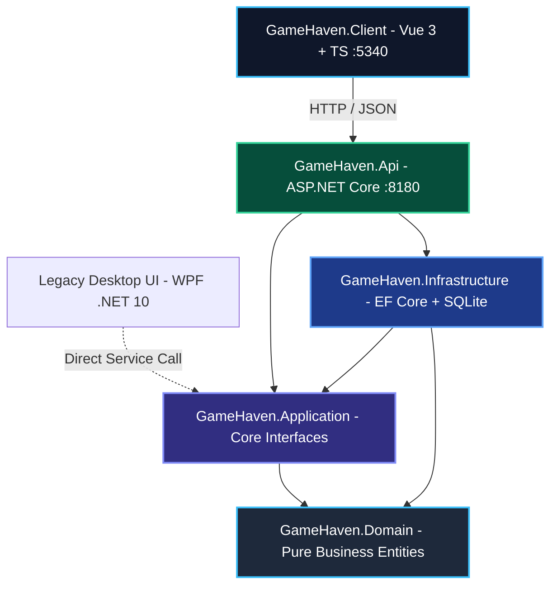

# System Architecture — GameHaven

## 1. Context & Structural Overview

GameHaven implements **Clean Architecture** with inward-pointing dependencies. The pure business domain has zero external dependencies.

## 2. Layer Responsibilities

| Project | Target Framework | Responsibilities | Forbidden Dependencies |
| :--- | :--- | :--- | :--- |
| **`GameHaven.Domain`** | `net10.0` | Entities (`Game`, `Cart`, `UserLibrary`), Enums, Domain Invariants, monetary math. | Any outer layer (`Application`, `Infrastructure`, `Api`, UI), EF Core, ASP.NET. |
| **`GameHaven.Application`** | `net10.0` | Repository interfaces (`IGameRepository`, `ICartRepository`, `ILibraryRepository`), use cases. | `Infrastructure`, `Api`, Web/UI libraries. |
| **`GameHaven.Infrastructure`** | `net10.0` | EF Core DbContext, SQLite provider, migrations, repository implementations, seed data. | `Api`, UI frameworks. |
| **`GameHaven.Api`** | `net10.0` | REST API routes, rate limiting, OpenAPI/Swagger generation, CORS, JSON serialization. | Direct client dependencies. |
| **`GameHaven.UnitTests`** | `net10.0` | Domain invariant unit tests and `NetArchTest` architectural fitness functions. | N/A |
| **`GameHaven.Client`** | Node / Vite / Vue 3 | Reactive single-page storefront, offline catalog fallback, `<nain-ecosystem-bar>` integration. | Server runtime components. |
| **`GameHaven.DesktopUI`** | `net10.0-windows` | Historical legacy WPF UI, kept for parity verification with modern endpoints. | Direct database access. |

## 3. Data Storage & Seed Strategy

- **Persistence**: SQLite database engine (`gamehaven.db`) via Entity Framework Core 10.
- **Initialization**: Automatic execution of `DataSeeder.SeedAsync` on application startup if the catalog table is empty.
- **Client Offline Mode**: The Vue 3 client bundles an embedded data snapshot in `src/data/mockGames.ts`, providing zero-friction instant demo access if the backend API is offline.
